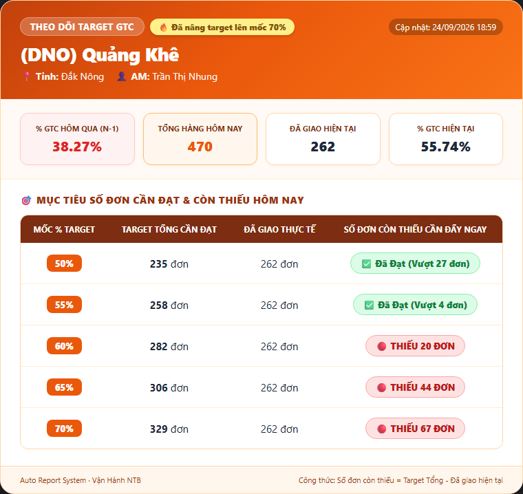
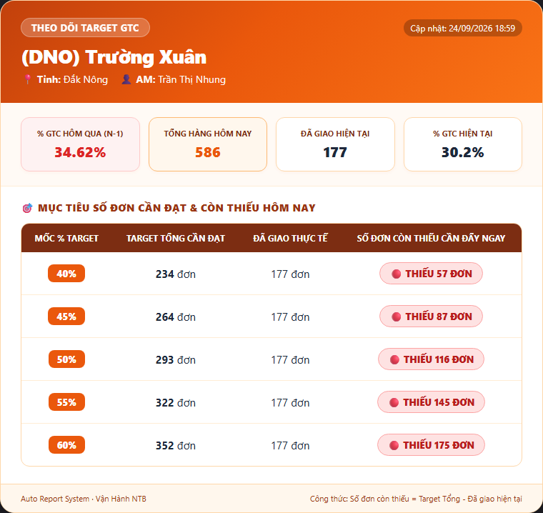

# 🏆 GHN AI REVOLUTION 2.0 — DỰ ÁN DỰ THI CHECKPOINT 2
## TÊN SẢN PHẨM: TRỢ LÝ ĐUA TARGET % GTC, NĂNG SUẤT REAL-TIME & TARGET THOÁT BỂ BƯU CỤC BẤT ỔN
> **Phân hệ Tác Chiến Vận Hành Tự Động (Auto-Ops & Target Tracker NTB)**  
> **Tác giả:** Trần Ngọc Trung – Ban Vận Hành Vùng Nam Trung Bộ (NTB)  
> **Kết quả Checkpoint 1:** ĐẠT (8.1/10 Điểm)  
> **Mục tiêu Vòng Showcase (17/11/2026):** Tuyển chọn Top 4 Sản phẩm xuất sắc nhất toàn quốc

---

## 📌 I. TỔNG QUAN VẤN ĐỀ & GIÁ TRỊ VẬN HÀNH THỰC TẾ
- **Chỉ số sống còn:** Tỷ lệ Giao Thành Công (%GTC) là chỉ số sống còn hàng ngày của bưu cục GHN.
- **Nỗi đau hiện trường:** Trong ca làm việc, AM và Trưởng bưu cục không biết thời gian thực mình đang đạt bao nhiêu % và **còn thiếu chính xác bao nhiêu đơn nữa** để chạm mốc thưởng hoặc thoát cảnh báo bất ổn.
- **Hậu quả trước đây:** Hàng loạt bưu cục bị lỡ mốc cam kết chỉ vì thiếu 2 - 5 đơn vào cuối ngày. Quản lý mất gần 1 tiếng mỗi ngày tải và xử lý các file Sheet nặng để tính toán thủ công.

---

## 📊 II. ĐO LƯỜNG TÁC ĐỘNG THỰC TẾ (BEFORE vs. AFTER)
*Sau hơn 2 tháng vận hành liên tục trên dữ liệu thật của 150+ bưu cục NTB (từ tháng 08 đến 01/11/2026):*

| Chỉ số vận hành cốt lõi | Trước khi có Tool | Sau khi triển khai Tool | Tác động cải thiện thực tế |
| :--- | :---: | :---: | :--- |
| **Tỷ lệ bưu cục đạt Target %GTC ngày** | ~68.0% | **84.5%** | **Tăng +16.5%** số bưu cục toàn vùng về đích thành công. |
| **Số ca trượt target sát nút (< 5 đơn)** | 6 - 8 bưu cục/ngày | **1 - 2 bưu cục/ngày** | **Giảm ~75%** số bưu cục bị lỡ mốc thưởng đáng tiếc. |
| **Số ca "thoát bể" khung giờ vàng (16h - 18h)** | Hiếm khi kịp cứu | **4 - 6 bưu cục/ngày** | Nhờ số liệu đếm ngược số đơn thiếu, AM kịp dồn lực nước rút. |
| **Quy mô bưu cục bất ổn toàn vùng** | Đỉnh điểm **13 bưu cục** | **2 - 3 bưu cục** | **Kéo giảm ~80%** số bưu cục rơi vào khủng hoảng vận hành. |
| **Thời gian làm báo cáo thủ công** | 45 phút/ngày | **0 phút (Tự động 100%)** | Giải phóng 100% thời gian cho 14+ AM đôn đốc hiện trường. |

---

## 🚀 III. CÁC TÍNH NĂNG MỚI ĐỘT PHÁ TẠI CHECKPOINT 2

### 1. Thuật toán AI: "Target Đếm Ngược Thoát Bể Bưu Cục Bất Ổn"
- **Nỗi đau:** Giai đoạn cao điểm, vùng NTB có ngày bùng phát đỉnh điểm tới **13 bưu cục lọt vào nhóm bất ổn** (%GTC 7 ngày < 45% hoặc tụt > 30% so với phong độ đỉnh). AM hoang mang vì không biết hôm nay phải giao bao nhiêu đơn mới kéo được bưu cục ra khỏi nhóm đỏ.
- **Giải pháp:** Hệ thống tự động tính toán ngược số đơn cần giao trong ca hôm nay để %GTC 7 ngày vượt qua ngưỡng sàn 45%:
  - *Bưu cục Đông Gia Nghĩa (Đắk Nông):* Target thoát bể là **222 đơn** (đạt 52% là thoát bể hôm nay).
  - *Bưu cục Quảng Khê (Đắk Nông):* Target thoát bể là **330 đơn** (đạt 71% là thoát bể hôm nay).
  - *Bưu cục Tân Hà Lâm Hà (Lâm Đồng):* Target thoát bể là **458 đơn** (đạt 85% là thoát bể hôm nay).
- **Kết quả minh chứng:** Báo cáo ngày 01/11/2026 ghi nhận bưu cục **(DNO) Trường Xuân** (AM Trần Thị Nhung) đã chính thức nhận huy hiệu **`✅ ĐÃ THOÁT CẢNH BÁO THÀNH CÔNG`**.

---

### 2. Thẻ Card Target 5 Mốc & Năng Suất NVPTT Real-time
Tự động tính 5 mốc target động (40% - 45% - 50% - 55% - 60%) dựa theo Volume hôm nay và ngày N-1; bóc tách chi tiết số đơn đã giao / đang giữ của từng nhân viên giao hàng trong ca.

| Card Target Quảng Khê | Card Target Trường Xuân (Đã thoát bể) |
| :---: | :---: |
|  |  |

---

## 🔒 IV. HẠ TẦNG CLOUD & BẢO MẬT NHÂN SỰ (DATA ISOLATION)
1. **Cloud CI/CD 24/7:** Chuyển giao toàn bộ lên máy chủ Cloud GitHub Actions, chạy tự động theo các khung giờ chiến lược (07h15, 11h30, 15h00, 16h30, 21h00, 22h00). Không phụ thuộc máy cá nhân.
2. **Cào dữ liệu trực tiếp:** Headless browser lấy số trực tiếp từ Dashboard GHN nội bộ, triệt tiêu độ trễ dữ liệu.
3. **Phân quyền tuyệt đối theo AM (Data Isolation):**
   - Bảng năng suất chi tiết từng nhân viên (Mã NV, Họ tên NV) **tuyệt đối không gửi vào kênh chat chung**.
   - Dùng thuật toán lọc `df_am = df[df['AM'] == am_name]` kết hợp `am_channel_map.json`. Mỗi AM chỉ nhận được thông tin bưu cục và nhân sự của mình.

---

## 📱 V. LỘ TRÌNH CHUYỂN DỊCH LÊN GTALK MINIAPP FRAMEWORK CỦA GHN
Bám sát tài liệu hướng dẫn 6 bước của Khối Công Nghệ GHN:
- Đã đăng nhập và khởi tạo hồ sơ ứng dụng trên **GTalk Back Office Tool** (App Name: `Target Tracker & Auto-Ops NTB`).
- Chuẩn hóa Design System theo Brand Identity GHN (Tone màu Cam `#FF5200` và Xanh `#006FAD`).
- Sẵn sàng xuất bản chính thức trên GTalk Miniapp Market để trình diễn tương tác 2 chiều tại Vòng Showcase ngày 17/11/2026.

---
*Tác giả: Trần Ngọc Trung — Vận hành Vùng Nam Trung Bộ (GHN Express)*
